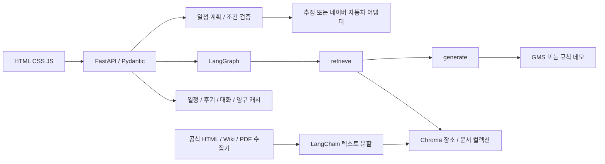

# 설계

## 구성

## 데이터

장소: 안정 ID, 이름, 지역, 분류, 태그, 주소, 좌표, 설명/활동, 가격 범위·단위, 영업시간/휴무/중간 휴식/입장 마감, 예약, 체류 추정과 근거, 실내외, 출처/시점, 미디어 배열, 평점 및 분위기. 없는 필드는 null 또는 빈 미디어 배열. 실제 장소에는 운영기관 정보가 자동 채워지지 않는다.

문서: ID, place_id, 제목, 본문, source, type, collected_at, license, own, page. 동일 원문이라도 장소 ID가 다르면 별도 연결을 보존한다. 수집 원문과 앱의 확인된 가격 필드는 자동 동기화하지 않는다. 운영정보 정규화는 별도 검수 단계다.

Chroma: `{mode}-places-{model_hash}`, `{mode}-documents-{model_hash}`. 장소당 JSON 검색 텍스트 하나. 문서 owner는 `place_id::document_id`, 청크 ID는 owner+순번+본문 SHA-256. upsert 후 새 ID 집합에 없는 이전 청크 삭제. 여러 문서/장소 간 덮어쓰기 방지. 삭제된 전체 문서의 자동 가비지 컬렉션은 없으며 새 버전의 동일 문서 청크만 정리한다.

데모 임베딩은 256차원 문자 bigram 해시다. GMS 의미 모델과 물리 컬렉션을 분리한다. 모델명을 바꾸면 새 컬렉션을 생성한다. 대형 데이터 색인은 배치 40건. 모델 차원이나 모델 자체 변경 시 새 모델명을 사용해야 한다.

## 수집·프롬프트

`QUERY_PROMPT`: 장소 조사 전문가 역할, JSON queries, 장소명+지역 자체 검색어 강제. `SELECT_PROMPT`: 제목/요약 관련성, JSON ids, 동명 장소 구별, `own=True` 문서는 결과 밖이어도 유지. LLM 없는 선택기는 엄격한 이름/지역 문자 규칙이며 의미 판별로 표시하지 않는다.

위키 API 검색·본문 TTL 7일, 성공 응답만 SQLite 캐시, 오류는 캐시하지 않음, `--refresh`로 갱신. 네트워크 요청은 제한된 재시도와 호출 간격. 현재 환경 403으로 위키 원문 수집 실적 0. 공식 HTML은 허용 URL 목록과 robots 확인, 7일 파일 캐시. 안내 페이지 2건은 정상 수집. PDF 파서는 페이지별 본문과 장소명 존재를 검증하나 조사 URL 404로 수집 0건.

## 두 노드 RAG

1. retrieve: 선택 장소 메타데이터를 모두 포함하고 같은 장소 ID 범위의 외부 청크 Top-k 검색. source+body 중복 제거 후 근거 번호 부여.
2. generate: 키 없으면 확인된 메타데이터 필드에 대한 규칙 응답. 키가 있으면 LangChain 구조화 출력으로 질문 관련 원문 발췌와 번호만 선택. 외부 문서의 명령을 따르지 않는 시스템 프롬프트.
3. 번호 존재와 원문 부분 문자열 일치를 별도 검사. 검증된 원문 발췌만 응답하여 자유 생성 사실을 표시하지 않는다. 원문이 옳은지, 문맥이 질문을 지지하는지까지 자동 판정한 것은 아니며 평가 양식에서 사람 검수.
4. 생성 캐시는 질문·자료 본문·최근 대화·모델·모드·버전 해시로 관리, TTL 1일. 실패/색인 없음은 캐시하지 않는다. 검색은 캐시 응답에서도 재실행하므로 근거 갱신을 감지한다.

place/plan 대화 범위는 `mode:kind:id`. 사용자별 서버 쿠키로 분리하며 상담 기록에 다른 장소 대화가 섞이지 않는다.

## 일정·경로·비용

조건 필터 → 빔 탐색(60개) → 모든 구간 계산 → 도착/대기/체류 → 영업/휴무/입장/휴식 시간 → 종료/도보/예산 상한 → 최대 3개. 같은 장소 집합의 순서만 바꾼 일정은 중복 추천하지 않는다. 탐색은 근사 방식이어서 전역 최적 또는 가능한 모든 일정 발견을 보장하지 않는다. 이동 총시간을 줄여 불필요한 왕복을 억제하지만 도로 제약 기반 최적화는 아니다.

자연어의 예산·개수·테마 일부를 규칙으로 추출해 폼에 표시한다. 부정 표현은 자동 테마 적용을 중단하고 직접 확인을 안내한다. 기타 요청은 보관하되 임의 문장 전체를 자동 필수 조건으로 처리하지 않는다.

운영·휴무·체류 또는 이동 시간이 없으면 검증 가능한 일정 생성에서 제외한다. 가격 미확인은 비용표 amount=null이며 알려진 합계만으로 전체 예산 보장을 주장하지 않는다. 실제 데이터가 현재 이 상태이므로 실제 추천은 빈 결과가 정상이다.

출발→첫 장소, 모든 장소 사이, 선택 귀가 구간을 포함. 데모는 직선거리와 속도(도보4, 자전거12, 자동차25, 대중교통18km/h; 대중교통 대기8분·도보6분 가정). 네이버 앱 링크와 API 계산 구분. 실제 API는 자동차만, 5분 캐시, 현시점 교통 정보라 미래 방문일 예측이 아님. 자동차 비용에 유류비와 통행료만 사용하며 택시비는 더하지 않음. 주차·미확인 통행료·자전거 대여비는 확인 필요.

비용은 [최솟값,최댓값] 구간으로 유지. 인당 단가는 인원을 곱하고 상한으로 예산 검사. confirmed/estimated/unknown 분리, 확인 비용+추정 비용 및 차액 범위 표시. 외부 평점 자료가 없어 합성 지표는 제공하지 않는다.

교체는 원본 일정 조건으로 모든 장소와 경로를 재검증한다. 원본은 보존하고 새 버전의 parent 연결 생성. 고정된 위치의 교체를 거부하고 나머지 장소/순서는 유지. 되돌리기는 parent 일정 반환.

## 후기·권한

집계 키 = SHA256(순서 있는 장소 ID JSON). 예산/날짜/시간 변경은 집계 키에 영향 없음, 장소/순서 변경은 별도 키. 세션+집계 키 UNIQUE 제약으로 갱신. 별명·방문일·작성일·내용·별점 저장. 같은 세션 연속 쓰기 3초 제한. 신고는 리뷰+세션별 1건 upsert, 신고만으로 자동 무효화하지 않음.

유효 후기 0~9건은 집계 중, 10건 이상 평균 공개. 삭제/valid=0으로 10 미만이면 다시 집계 중. 자체 후기와 외부 평점 분리. 실인증이 아닌 브라우저 세션 데모임을 표시. HTTP-only SameSite cookie, SQL 파라미터화, 작성자 소유권, Origin 검증. 2 MiB 요청/후기 본문 최대 500,000자. 인증·분산 rate limit·관리자 UI는 후속 작업.
